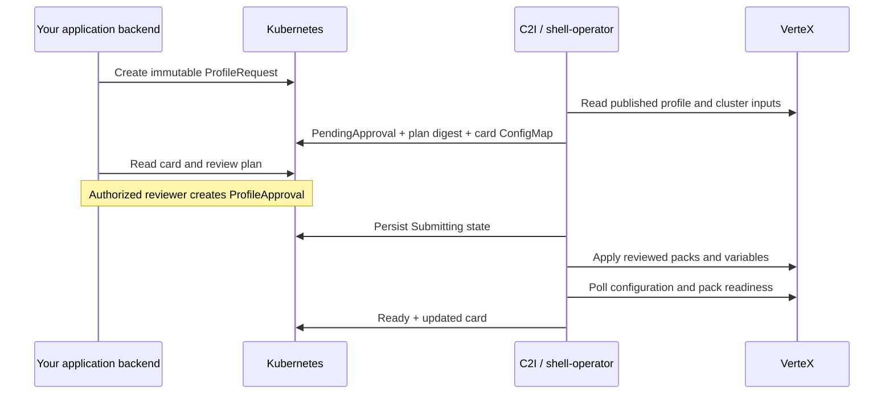

# C2I operator

Embed VerteX add-on profile controls in your application: generate profile cards, edit deployment settings, request a change, and approve the reviewed plan before installation.

This community reference implementation uses [shell-operator](https://github.com/flant/shell-operator) for Kubernetes event handling and scheduled reconciliation. It includes a Python controller, namespaced custom resources, separate requester and approver roles, a card generator, and a framework-neutral web component. It is not an official Spectro Cloud product.

**Status: experimental, v0.1.0.** The first version updates an **already attached add-on profile on an existing cluster**. Attach the profile in VerteX first. Cluster creation, infrastructure profiles, profile authoring/publication, profile attachment/removal, and rollback are outside this version's scope. No demonstration environment data or credentials are included.

## How it works



An approval is bound to the Kubernetes request UID, generation, target cluster, operator endpoint/project, existing deployed configuration, published pack content, and proposed inputs. Changed content or a changed baseline produces a new digest that needs a new approval. Recreating a request does not reuse its approval.

The operator preserves existing deployment inputs and overrides only requested variables. It does not publish changes to a shared profile. `Ready` means VerteX reports the expected packs, variables, successful pack conditions, a running cluster, and an apply timestamp after submission. Application-specific health checks belong in your application.

## Prerequisites

- Kubernetes 1.26+ with CRD CEL validation, `kubectl`, and a container registry or local kind cluster.
- An existing VerteX project, healthy cluster, and attached, published **add-on** profile.
- A project-scoped API key permitted to read profiles and cluster variables and update/apply cluster profiles. Restrict its project and role to the intended targets.
- Editable, non-sensitive variables defined on your profile. Settings use their exact names; values are strings. VerteX remains the final validator for variable format and pack constraints.

## Install

Build and push the image to a registry your cluster can reach:

```sh
git clone https://github.com/millerjem/c2i-operator.git
cd c2i-operator
docker build -t YOUR_REGISTRY/c2i-operator:0.1.0 .
docker push YOUR_REGISTRY/c2i-operator:0.1.0
```

Edit `deploy/operator.yaml`: replace the image, `VERTEX_PROJECT_UID`, and `C2I_ALLOWED_CLUSTERS`. The cluster allowlist is comma-separated, without spaces. Set `VERTEX_ENDPOINT` to your HTTPS VerteX origin if different. Keep one replica and the `Recreate` strategy.

```sh
kubectl apply -f deploy/crds.yaml
kubectl wait --for=condition=Established --timeout=60s crd/profilerequests.c2i.dev crd/profileapprovals.c2i.dev
kubectl create namespace c2i-system --dry-run=client -o yaml | kubectl apply -f -
# Point to an existing local file containing only the API key.
# Do not add this file to Git.
kubectl -n c2i-system create secret generic c2i-vertex --from-file=api-key=/path/to/api-key
kubectl apply -f deploy/operator.yaml
kubectl -n c2i-system rollout status deployment/c2i-operator
```

For local development, use `docker build -t c2i-operator:dev .` and `kind load docker-image c2i-operator:dev --name YOUR_KIND_CLUSTER` instead of pushing. Explicitly select your local kube context before applying manifests.

The operator watches only `c2i-system` and polls every 30 seconds. To change namespaces, update every namespace in the deployment, role bindings, requests, and approvals. Install one operator per trust boundary and give its key only that project's access.

## Request a settings change

Copy `examples/profile-request.yaml`. Replace the cluster and profile IDs and set the published profile version. Replace `application_replicas` with an editable variable from your own profile.

```yaml
apiVersion: c2i.dev/v1alpha1
kind: ProfileRequest
metadata:
  name: application-config-001
  namespace: c2i-system
spec:
  displayName: Application services
  clusterUid: REPLACE_WITH_CLUSTER_UID
  profileUid: REPLACE_WITH_ADDON_PROFILE_UID
  profileVersion: '1.0.0'
  settings:
    application_replicas: '3'
```

```sh
kubectl create -f examples/profile-request.yaml
kubectl -n c2i-system get profilerequests
kubectl -n c2i-system get profilerequest application-config-001 -o json
```

Requests are immutable. Create a new request name for each settings change. Settings are stored in Kubernetes resources: **never put secrets in them**. Sensitive, hidden, immutable, and unknown profile variables are not editable through this operator. Sensitive variables and credential-like names are excluded from generated settings forms. Existing secret inputs are preserved in the outbound request but stored only as a digest in status.

An empty settings object requests the published pack configuration while preserving deployment variables. The referenced profile version must match the published version returned for that profile UID.

## Review and approve

Read the request status and generated card. Review the target, proposed settings, and the actual published profile packs in VerteX. The card includes hashes for the deployed baseline and proposed profile content; it intentionally does not copy raw pack values into a public card. Approvers need read access in VerteX to inspect full pack changes.

```sh
kubectl -n c2i-system get profilerequest application-config-001 -o jsonpath='{.metadata.uid}{"\n"}{.status.planDigest}{"\n"}'
```

Copy those values into `examples/approval.yaml`, choose a unique approval name, and create it **as an authorized reviewer**:

```sh
kubectl create -f examples/approval.yaml
kubectl -n c2i-system get profilerequests -w
```

Use `decision: Reject` to reject a pending plan. Rejection wins if matching approval and rejection records are both present before submission. Once submitted, rejection cannot cancel the external operation. Approval attribution comes from Kubernetes API audit logs, not a user-supplied reviewer field. Enable audit logging for durable reviewer identity.

Bind `c2i-requester` to your application backend service account and `c2i-approver` to a separate reviewer group/service account. Example reviewer binding, after replacing the group:

```sh
kubectl -n c2i-system create rolebinding c2i-reviewers --role=c2i-approver --group=YOUR_REVIEWER_GROUP
```

The requester role cannot create approvals or change status. The operator can read approvals but cannot create them. Administrators remain trusted. An application that uses one privileged backend identity for both actions must enforce equivalent role separation itself.

## Add cards to your application

Every request generates a ConfigMap named `c2i-<request-name>` containing `data["card.json"]`. Expose that JSON through your **authenticated backend**, filtered to the current user's authorized project and cluster. Do not expose Kubernetes or VerteX credentials to the browser.

Copy `web/profile-card.js` into your application assets:

```html
<c2i-profile-card id="profile"></c2i-profile-card>
<script type="module">
  import '/assets/profile-card.js';
  const card = document.querySelector('#profile');
  card.card = await fetch('/api/profiles/application-config-001/card').then(r => r.json());

  card.addEventListener('c2i-request', async ({ detail }) => {
    // Your backend validates authorization and copies the approved target mapping.
    // It creates a NEW immutable ProfileRequest with detail.settings.
    const response = await fetch('/api/profile-requests', {
      method: 'POST', headers: { 'Content-Type': 'application/json' },
      body: JSON.stringify(detail)
    });
    if (!response.ok) throw new Error('Settings request failed');
  });

  card.addEventListener('c2i-approve', async ({ detail }) => {
    // Reviewer-only route: reread status and compare requestUID + planDigest.
    const response = await fetch('/api/profile-approvals', {
      method: 'POST', headers: { 'Content-Type': 'application/json' },
      body: JSON.stringify(detail)
    });
    if (!response.ok) throw new Error('Approval failed');
  });
</script>
```

These `/api/...` routes are **your application's integration contract**, not endpoints provided by the operator. Implement them using your existing login, role checks, CSRF protection, tenant/cluster authorization, and Kubernetes client. Never trust browser-supplied target IDs or approval authority. Refresh the card after writes and while changes are pending. Card buttons emit events; they do not contact VerteX directly.

| Application route | Backend action |
| --- | --- |
| `GET /api/profiles/:name/card` | Authorize request access; read its owned ConfigMap and return parsed `card.json`. |
| `POST /api/profile-requests` | Check requester role; map requestUID to an authorized target; validate settings; create a new ProfileRequest with a unique name. |
| `POST /api/profile-approvals` | Check reviewer role; reread PendingApproval status; verify UID/digest; create an immutable ProfileApproval. |

The form derives labels, choices, formats, and values from profile variable definitions and current deployment inputs. The generic form sends strings; add product-specific validation to your backend. Hide the approval action from users without the reviewer role. The operator independently checks the matching approval resource.

### Preview and generate cards

Run the fixture preview with no cluster or credentials:

```sh
python3 -m http.server 8080 --bind 127.0.0.1
# Open http://127.0.0.1:8080/examples/
```

The preview logs request and approval events on the page and makes no updates.

Export a live generated card:

```sh
kubectl -n c2i-system get configmap c2i-application-config-001 -o jsonpath='{.data.card\.json}' > card.json
```

Or generate card JSON offline from exported resources:

```sh
kubectl -n c2i-system get profilerequest application-config-001 -o json > request.json
python3 tools/card.py request.json --profile /path/to/exported-profile.json --output card.json
```

Offline generation uses requested values or profile defaults; use the live ConfigMap when you need current deployment inputs. A profile export is needed to generate the editable field list. Do not commit exports containing private profile or application data.

## Failure handling and limits

| Phase | Meaning |
| --- | --- |
| `PendingApproval` | Read-only plan created; cluster unchanged by C2I. |
| `Rejected` | A reviewer rejected this exact plan. |
| `Submitting` | Submission intent persisted before the external call. |
| `Applying` | API accepted submission; waiting for reported configuration and pack readiness. |
| `Ready` | Expected configuration and pack readiness confirmed by VerteX. |
| `Drifted` | A previously confirmed configuration changed; C2I does not reapply it. |
| `SubmissionUncertain` | A timeout/restart may have occurred after acceptance; no automatic retry. |
| `Blocked` | Target, version, profile, settings, or API access needs attention. |

A `SubmissionUncertain` request blocks additional submissions to that cluster. Inspect the cluster in VerteX. If the expected configuration appears, polling can mark it Ready. If it did not apply, an administrator must archive the request's audit evidence and delete the old request before a new request can proceed. Creating a new request alone does not bypass an uncertain operation. There is no force-retry or automatic rollback.

Only one in-flight request per cluster is processed by this operator. Do not scale it above one replica or install overlapping operators against the same targets: distributed leader election is not implemented. There is no cross-system transaction or conditional write in the VerteX API workflow; coordinate other tools and operators so they do not mutate the same cluster during review/submission. Changes between read and apply cannot be eliminated by this implementation.

Deleting a request garbage-collects its card. It does **not** uninstall the profile or roll back an accepted update. Keep requests and approvals for audit retention. This sample does not enforce four-eyes identity separation, add a custom admission webhook, provide a production application API, or replace application health checks.

## Development and validation

```sh
python3 -m unittest discover -s tests -v
node --test tests/card.test.mjs
python3 hooks/reconcile.py --config
```

Tests cover approval binding, stale plans, drift, rejection, API timeouts, interrupted submissions, status conflicts, sensitive inputs, and readiness. GitHub Actions also builds the container. Validate against a disposable cluster and your VerteX API version before production use.

## References

- [Shell-operator hooks and reconciliation](https://flant.github.io/shell-operator/HOOKS.html)
- [Running shell-operator](https://flant.github.io/shell-operator/RUNNING.html)
- [Patch cluster profiles API](https://docs.spectrocloud.com/api/v1/v-1-spectro-clusters-uid-profiles-patch/)
- [Profile variables](https://docs.spectrocloud.com/profiles/cluster-profiles/create-cluster-profiles/define-profile-variables/)
- [Apply profile updates](https://docs.spectrocloud.com/profiles/cluster-profiles/modify-cluster-profiles/update-cluster-profile/)

## License

MIT. Spectro Cloud, VerteX and other marks belong to their respective owners.
